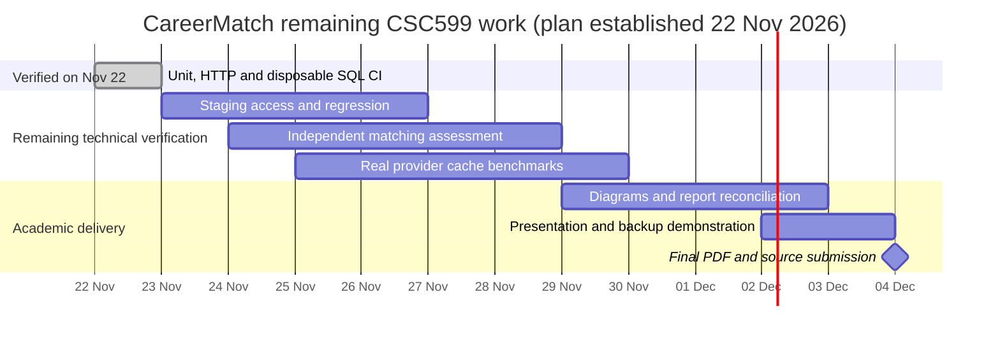

# CSC599 CareerMatch: current release plan, not a reconstructed historical plan

**Prepared:** 22 November 2026  
**Student:** Wassim Chalak (202306966), individual capstone  
**Supervisor:** Dr. Chadi Helwe  
**Submission deadline:** 4 December 2026  
**Management tool used for this current plan:** GitHub Issues [#2–#6](https://github.com/Wassimchalak/CareerMatch/issues).  
**Scope:** remaining verification, documentation and submission. The original June–November implementation was not tracked in a formal contemporaneous Gantt tool; historical milestones may only be inferred from verified Git commits and the student's recollection, clearly labeled.

## Work breakdown, owners, acceptance criteria

| WBS | Task / link | Planned dates (2026) | Owner | Evidence and completion rule | Status at creation |
|---|---|---|---|---|---|
| 1.1 | Automated backend tests and CI | Nov 22 | Student, assisted review | Green GitHub Actions with TRX evidence | Completed (run 45021712378) |
| 1.2 | ASP.NET Core request-pipeline tests | Nov 22 | Student, assisted review | Authentication, validation and production docs checks green | Completed (9 tests) |
| 1.3 | Disposable SQL regression tests | Nov 22 | Student, assisted review | Dapper SQL queries, data isolation, score freshness and cache hit green | Completed (6 tests) |
| 1.4 | Staging/production regression review [#2](https://github.com/Wassimchalak/CareerMatch/issues/2) | Nov 23–26 | Student | Full staging workflows signed off | Pending |
| 2.1 | Anonymized, independent AI scoring review [#3](https://github.com/Wassimchalak/CareerMatch/issues/3) | Nov 24–28 | Student + volunteer assessors | Real, consented ratings and raw model scores; 60% sensitivity reported | Pending |
| 2.2 | Controlled provider performance [#4](https://github.com/Wassimchalak/CareerMatch/issues/4) | Nov 25–29 | Student | Raw timed data, cache-hit proof, error/variance analysis | Pending |
| 3.1 | Literature, diagrams, rubric and report [#5](https://github.com/Wassimchalak/CareerMatch/issues/5) | Nov 29–Dec 2 | Student | Exact 25–30 pages, source-linked claims, no unsupported evidence | In progress |
| 3.2 | Presentation, source delivery [#6](https://github.com/Wassimchalak/CareerMatch/issues/6) | Dec 2–4 | Student | Rehearsed fallback demo, PDF and source submitted | Pending |

Dates are **forward-looking targets established on 22 November 2026**, not proof that a task was carried out on a historical date. PR #1 is ready for human review but is not merged; full staging verification remains a release gate.

## Current Gantt chart

## Cost register: historical fact vs forward budget

| Service | Verified / student-reported cost status | Amount | Control before additional testing |
|---|---|---|---|
| OpenAI API | Student reported prior paid usage | Historical amount unknown | Estimate expected requests × model unit price; approve a test cap; avoid real CV uploads |
| Domain for CareerMatch/Resend | Student reported a paid domain purchase | Receipt/amount not supplied | Check renewal date and renewal price in registrar |
| Bebity via Apify | Currently **free tier** | No Bebity charge reported | Inspect free-tier limits before paid expansion |
| Resend | Used for password-recovery messages | Paid status not established | Check quota; never mail real recipients during automated tests |
| SQL/hosting | Deployment exists | Historical amount not independently verified | Monitor SQL/storage/backup and hosting bill |
| Student labor | Individual effort over June–November | No hours log; do not invent | No retrospective hourly estimate reported as fact |

No fabricated SAR, USD, or hours. Planned incremental test cost is constrained by the quotas/credits the student explicitly approves; repository tests use local fixtures and should not spend API credits.

## Cost evidence and non-AI planning scenario (forward estimate only)

**Updated 22 November 2026.** The student reported paying for OpenAI API usage and a domain purchase, but did **not** provide historical amounts or a current monthly OpenAI expense. The previous model-generated **$20/month OpenAI allowance was unsupported and has been removed**. Do not present an OpenAI monthly amount until model/token records and actual invoices support it.

The following is a **partial, illustrative non-AI scenario**, not a full project spending ceiling, not a payment history, not a vendor quote, and **not an estimate of OpenAI expense**. Current usage on Bebity/Apify is reported as free tier.

| Planning item | Illustrative USD/month | Basis and caveat |
|---|---:|---|
| MonsterASP.NET/SQL | $6.95 | Example introductory hosting rate at https://www.monsterasp.net/Pricing/ ; actual tier and renewal may differ |
| Apify/Bebity | $19.00 | Conditional starter tier **only if** free credits are insufficient, at https://apify.com/pricing/ ; actor usage not measured |
| Domain renewal | $1.50 | Hypothetical $18 annual renewal / 12; student’s actual paid or renewal amount not supplied |
| Resend and frontend hosting | $0.00 | Assumes free quotas remain adequate; verify https://resend.com/pricing |
| **Non-AI scenario subtotal** | **$27.45** | Only listed illustrative items |
| Non-AI contingency, 20% | $5.49 | 20% x $27.45 |
| **Illustrative non-AI scenario** | **$32.94/month** | **EXCLUDES OpenAI and any other unknown expenses** |
| **OpenAI usage** | **Unknown; not estimated** | Reconcile actual usage invoices, model/token rates and expected activity before forecasting |

The $32.94 figure is **not the total monthly project budget** or an expenditure cap; its simple annualization is **$395.28 before AI, taxes, overruns, or other services**. Historical OpenAI/domain amounts remain unverified. If real receipts are provided, record them separately from the prospective estimates. No budget figures should be described as historical spend.

## Risk register (current assessment, not historical logs)

Likelihood (L) and impact (I) are planning judgments from 1 (low) to 5 (high), with score L×I.

| Risk | L | I | Score | Mitigation / contingency | Owner |
|---|---:|---:|---:|---|---|
| Cross-account information exposure | 2 | 5 | 10 | JWT and SQL ownership tests; staging account separation; review downloads | Student |
| CV/AI output invents unsupported skills | 3 | 5 | 15 | Extraction checks, prompt restrictions, candidate review, independent rating | Student |
| Third-party provider outage, quota, latency | 4 | 4 | 16 | 24-hour cache, timeout, ten-job cap, fallback demo screenshots | Student |
| Outdated job results within cache interval | 3 | 3 | 9 | Document 24-hour freshness tradeoff, description hash invalidation | Student |
| Data migration / deployment misconfiguration | 3 | 4 | 12 | Disposable SQL tests; staging smoke tests; rollback plan before merge | Student |
| Academic evidence exceeds 30-page limit | 3 | 3 | 9 | Replace rather than append pages; automate PDF rendering/page count | Student |
| AI evaluation sample too small or subjective | 4 | 3 | 12 | Predeclare sample, independent reviewers, disclose limits | Student |
| Test spending exceeds free tier / credit | 2 | 3 | 6 | Stop limits, opt-in tests only, monitor usage | Student |

## Current reporting cadence

- GitHub Issues track each remaining workstream and acceptance criteria.
- Pull request #1 is the isolated integration/review gate.
- Updates are entered only when work is actually completed; CI run links provide machine-recorded evidence.
- The student should attach genuinely observed costs, dates, and reviews if available. No historic Trello/Agile/Scrum, team meetings, or retrospective timesheets are claimed.

## Distinguishing methodology from pattern

Development history: database-first and backend-first incremental delivery, manual method checks, Swagger validation, React integration, deployment. **Methodology** is iterative/incremental delivery, not proof of Scrum ceremonies. **Implementation patterns** include controller-service boundaries, DI, DTOs, SQL relational modeling, caching by content hash, and scoped JWT authorization. These are design mechanisms rather than management software.

## Limit on the official Exemplary management score

This GitHub Issues plan genuinely uses management software **from 22 November onward** and includes the required categories. It does not demonstrate that management software, a cost ledger and the Gantt chart existed throughout June–November. A 4/4 faculty score still requires the professor to determine whether current documented management work satisfies the rubric's Exemplary descriptor.
