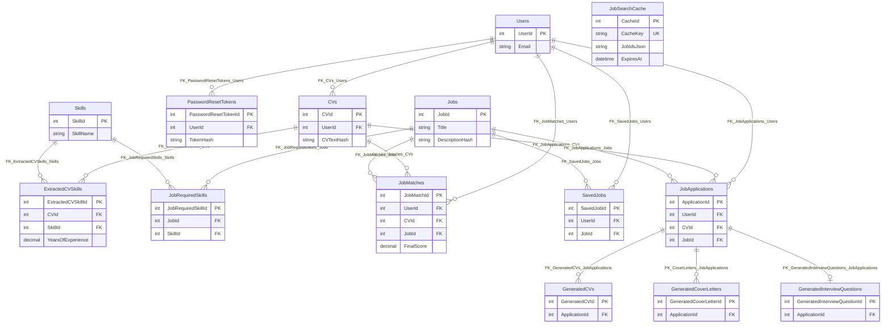
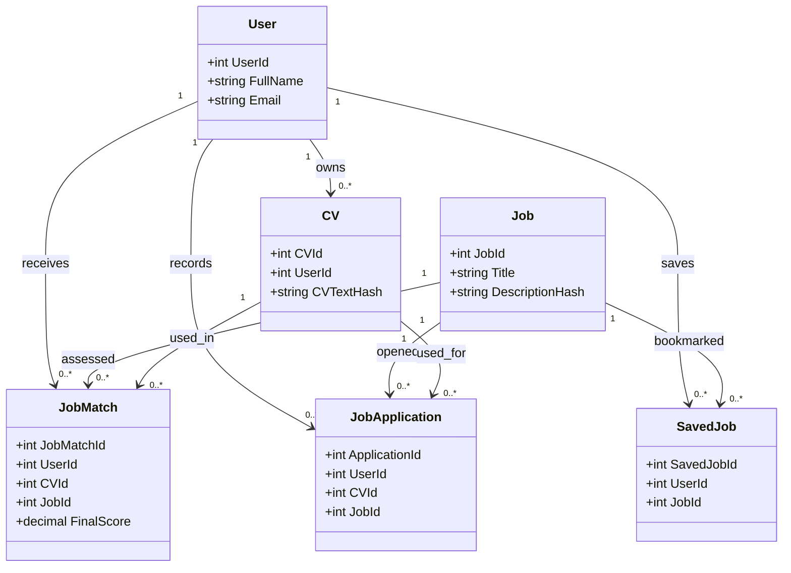
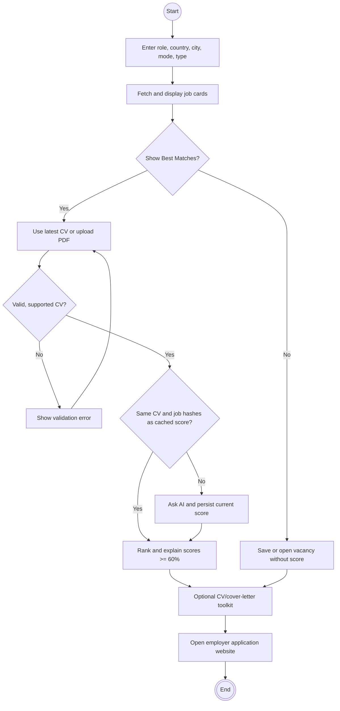
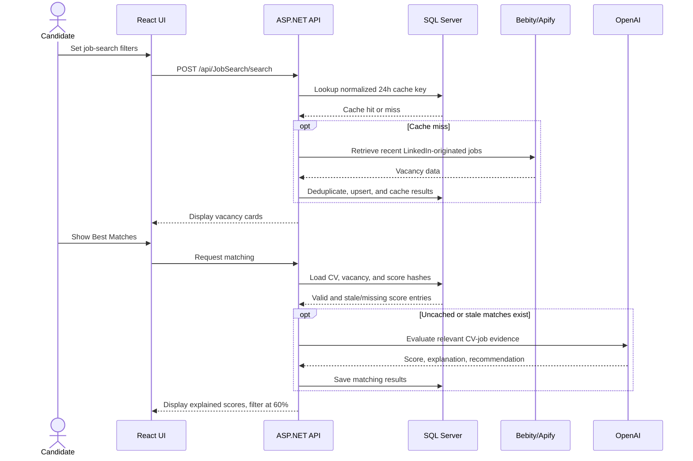

# CareerMatch architecture diagrams — editable source

**Updated:** 22 November 2026. Diagram relationships are grounded in the supplied SQL Server schema and the checked controller/service workflow. These source diagrams complement the legible, vector-rendered illustrations in the 30-page academic PDF.

## Complete SQL Server ERD (14 tables / 17 declared foreign keys)

The **actual UTF-16 SQL Server DDL dated 20 November 2026** was inspected and all 17 `FOREIGN KEY` constraints enumerated, rather than inferring relationships from similar-sounding table names. The report now presents readable **Figure 3a (page 9)** and **Figure 3b (page 10)** connected views; repeated parent boxes are visual references to the same real table. Every child has a PK as well as its named FK attributes, and cardinalities are shown.

**Cardinality caveat:** Each SQL FK requires its child row to reference a parent except **JobApplications.CVId**, which is nullable. The generated-interview table has a **UNIQUE ApplicationId** constraint and is therefore **0..1 per application**. The other generated document tables have no matching unique ApplicationId constraint and can contain multiple rows per application. `JobSearchCache.CacheKey` is **unique but not the PK**; `CacheId` is the PK. `JobSearchCache` has no FK to `Jobs`; `JobIdsJson` is serialized IDs.

## Selected UML domain classes

## Activity diagram

## Sequence diagram (conditional provider/AI calls)

The interface-level 60% cutoff is an uncalibrated product decision, not a verified hiring outcome. Application handoffs are not employer-side submission confirmations.
