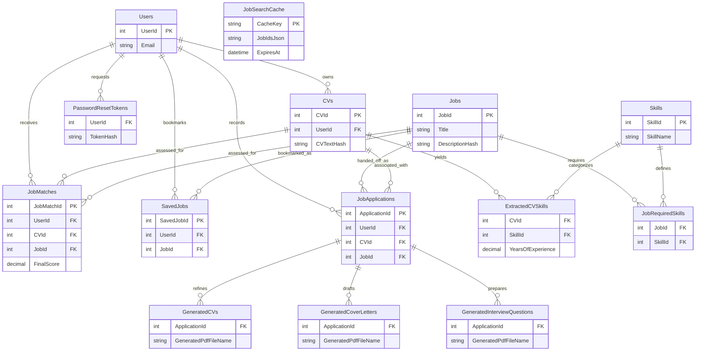
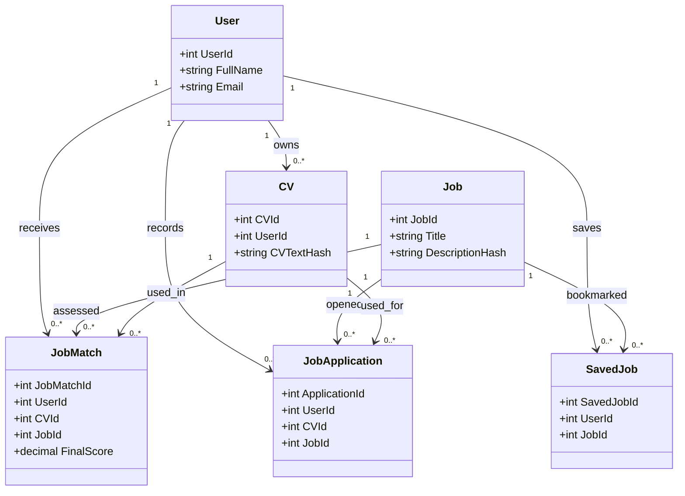
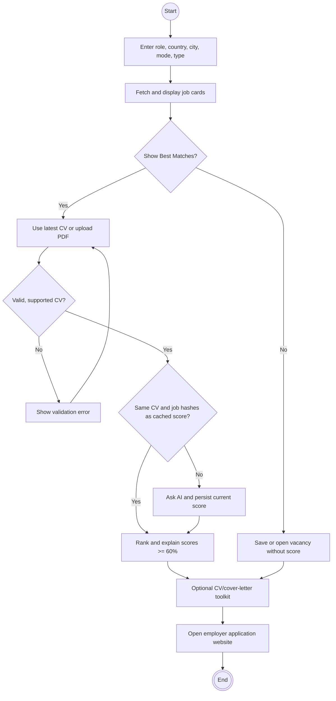
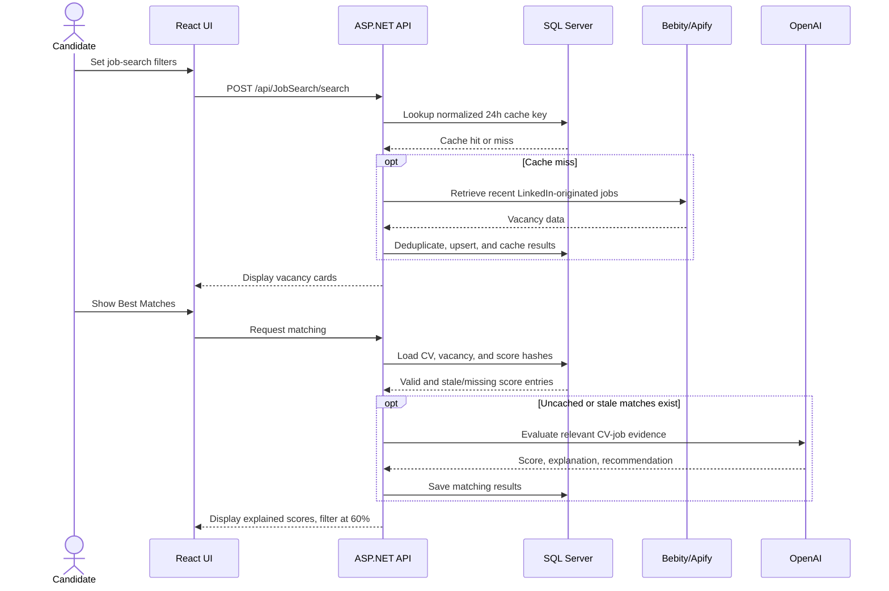

# CareerMatch architecture diagrams — editable source

**Updated:** 22 November 2026. Diagram relationships are grounded in the supplied SQL Server schema and the checked controller/service workflow. These source diagrams complement the legible, vector-rendered illustrations in the 30-page academic PDF.

## ER diagram (14-table schema, key relationships)

Note that `JobSearchCache` has no direct job FK; it contains serialized cached job identifiers. Direction and multiplicity follow the child-table foreign keys. The exact SQL DDL, not this reduced visual, is the authoritative schema for columns and constraints.

## Selected UML domain classes

## Activity diagram

## Sequence diagram (conditional provider/AI calls)

The interface-level 60% cutoff is an uncalibrated product decision, not a verified hiring outcome. Application handoffs are not employer-side submission confirmations.
